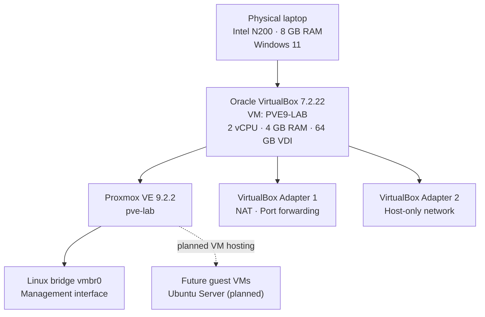

# Proxmox VE Lab Architecture

## Logical topology

The lab uses a Windows 11 host running Oracle VirtualBox. Proxmox VE is installed as a nested hypervisor guest.



## VirtualBox network adapters

| Adapter | Attachment | Purpose | Status |
|---|---|---|---|
| Adapter 1 | NAT | Proxmox management access and port forwarding | Configured |
| Adapter 2 | Host-only | Private host-to-lab connectivity | Configured and tested; bidirectional ping, TCP 8006/22, and SSH login succeeded |

### NAT port forwarding

| Host port | Guest port | Service |
|---:|---:|---|
| 2222 | 22 | SSH |
| 8006 | 8006 | Proxmox Web UI (HTTPS) |

## Proxmox network configuration

The current Proxmox configuration uses `vmbr0` as a static bridge connected to `nic0`. The second interface, `nic1`, is set to manual and is not yet attached to a bridge.

```text
auto lo
iface lo inet loopback

iface nic0 inet manual

auto vmbr0
iface vmbr0 inet static
    address <management-ip>/<prefix>
    gateway <gateway-ip>
    bridge-ports nic0
    bridge-stp off
    bridge-fd 0

auto nic1
iface nic1 inet static
    address 192.168.56.10/24
```

Replace the placeholders only in a private/local copy with the actual lab values. Do not publish credentials or sensitive network information.

## Host-only addressing and validation

| Endpoint | Interface | Address |
|---|---|---|
| Windows host | VirtualBox Host-Only Ethernet Adapter | `192.168.56.1/24` |
| Proxmox | `nic1` | `192.168.56.10/24` |
| Proxmox NAT bridge | `vmbr0` | `10.0.2.15/24` |

Host-only tests passed in both ping directions. Windows also reached TCP ports 8006 and 22, and SSH login to `root@192.168.56.10` succeeded. Windows Defender Firewall initially blocked inbound ICMP; the test succeeded after allowing the required ICMPv4 Echo Request traffic. The firewall remains enabled.

## Architecture notes

- The Proxmox management interface is reachable through the VirtualBox NAT port-forwarding rule and the Host-only address.
- Host-only networking is configured and connectivity has been tested.
- Guest VM deployment is planned and is not represented as completed.
- Nested KVM was verified while the Windows hypervisor launch configuration was temporarily disabled (`hypervisorlaunchtype off`): four `vmx` flags, `/dev/kvm` present, and KVM modules loaded.
- After Windows security protections were restored (`hypervisorlaunchtype auto`, VBS/HVCI running, Memory Integrity on), KVM was retested and was not exposed (`vmx/svm` count 0, no `/dev/kvm`, no KVM modules). Keep Windows protections enabled; use a suitable alternative host for routine KVM practice if needed.
