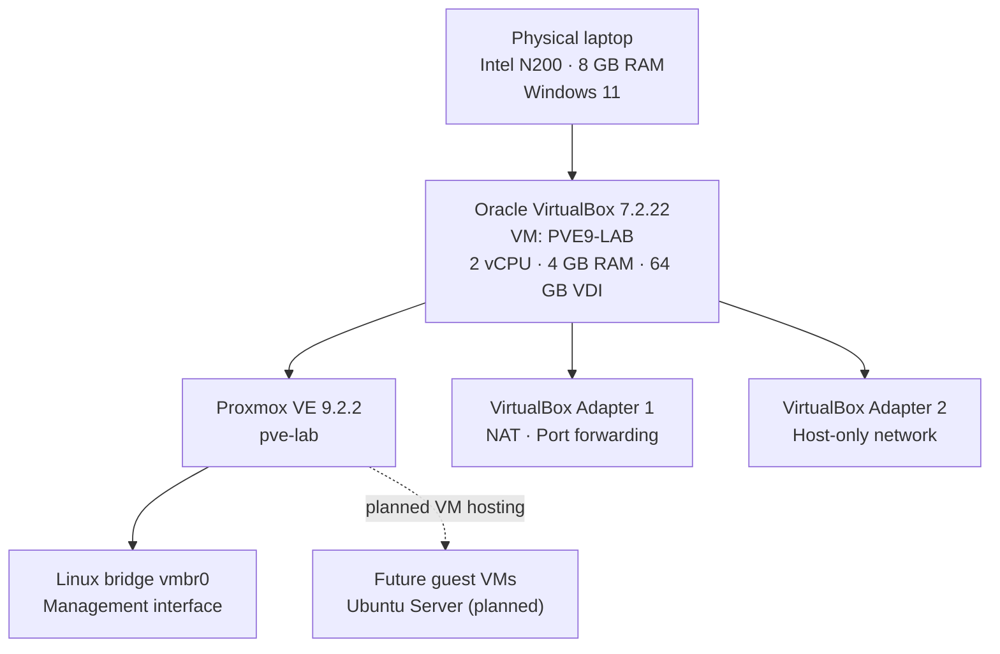

# Proxmox VE Lab Architecture

## Logical topology

The lab uses a Windows 11 host running Oracle VirtualBox. Proxmox VE is installed as a nested hypervisor guest.



## VirtualBox network adapters

| Adapter | Attachment | Purpose | Status |
|---|---|---|---|
| Adapter 1 | NAT | Proxmox management access and port forwarding | Configured |
| Adapter 2 | Host-only | Isolated host-to-lab connectivity | Configured; traffic testing pending |

### NAT port forwarding

| Host port | Guest port | Service |
|---:|---:|---|
| 2222 | 22 | SSH |
| 8006 | 8006 | Proxmox Web UI (HTTPS) |

## Proxmox network configuration

The current Proxmox configuration uses `vmbr0` as a static bridge connected to `nic0`. The second interface, `nic1`, is set to manual and is not yet attached to a bridge.

```text
auto lo
iface lo inet loopback

iface nic0 inet manual

auto vmbr0
iface vmbr0 inet static
    address <management-ip>/<prefix>
    gateway <gateway-ip>
    bridge-ports nic0
    bridge-stp off
    bridge-fd 0

iface nic1 inet manual
```

Replace the placeholders only in a private/local copy with the actual lab values. Do not publish credentials or sensitive network information.

## Architecture notes

- The Proxmox management interface is reachable through the VirtualBox NAT port-forwarding rule.
- The host-only adapter is reserved for a separate lab network; connectivity still needs to be tested.
- Guest VM deployment is planned and is not represented as completed.
- Nested KVM was verified while the Windows hypervisor launch configuration was temporarily disabled. Retest after restoring Windows virtualization security settings.
